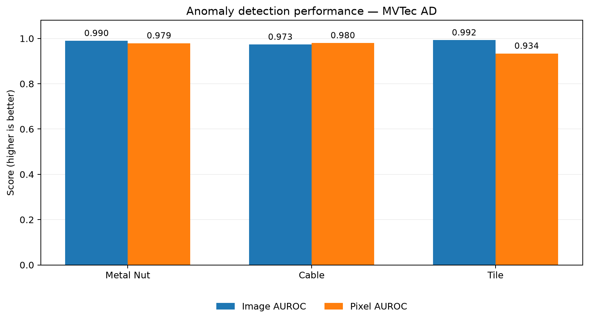
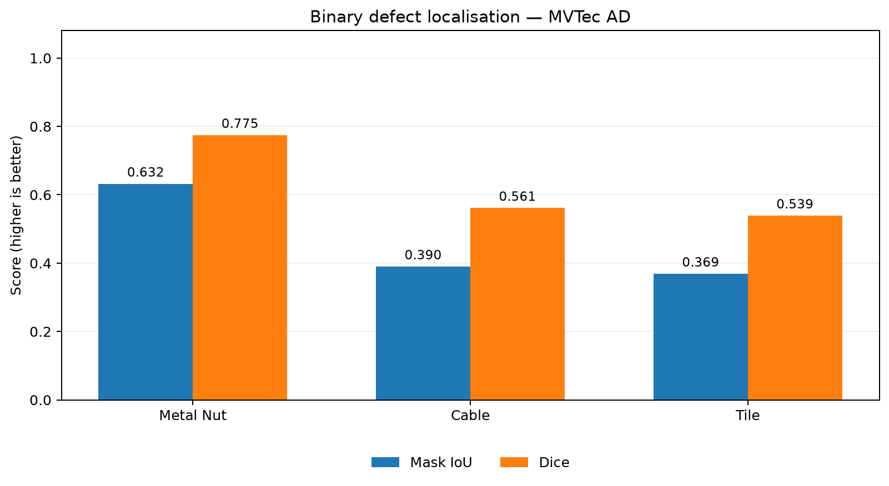

# Industrial Visual Anomaly Detection & Defect Localisation

**Multi-category industrial visual inspection using PatchCore, PyTorch, Anomalib, Streamlit, and SQLite.** The system learns normal product appearance from defect-free images, then detects anomalous products and highlights suspicious regions with heatmaps and binary masks.

**Categories:** Metal Nut · Cable · Tile  
**Benchmark:** MVTec AD · **382 held-out test images** across the three categories  
**Application:** Single-image inspection · Batch inspection · Category selection · Persistent inspection history

> **Research / portfolio demonstration.** Not validated for deployment in production quality-control systems.

## What it does

- Fits a separate **PatchCore (ResNet-18)** anomaly detector per product category using healthy training images only.
- Calibrates **image-level** and **pixel-level** anomaly thresholds from held-out healthy validation images, separately for each category.
- Classifies uploaded images as **NORMAL** or **ANOMALY**, with an anomaly score, heatmap overlay, and binary localisation mask.
- Supports batch inspections, CSV reports, PNG/ZIP mask exports, end-to-end timing, and SQLite inspection history.
- Compares PatchCore with a convolutional autoencoder baseline on Metal Nut.

## Benchmark results

Evaluations use the original **MVTec AD test partitions**. Thresholds were fixed using healthy validation images before testing; no test labels were used to set thresholds. Higher scores are better except for false-positive rate.

### Image-level anomaly detection

| Metric | Metal Nut | Cable | Tile |
|---|---:|---:|---:|
| Test images | 115 | 150 | 117 |
| Accuracy | **96.52%** | 91.33% | 92.31% |
| Precision | 98.90% | 94.38% | **100.00%** |
| Defect recall | **96.77%** | 91.30% | 89.29% |
| False-positive rate | 4.55% | 8.62% | **0.00%** |
| **Image AUROC** | 0.9897 | 0.9732 | **0.9924** |



### Pixel-level defect localisation

IoU and Dice are **micro-averaged over all test-set pixels**, including healthy test images. Ground-truth masks were resized using nearest-neighbour interpolation to match prediction-map resolution.

| Metric | Metal Nut | Cable | Tile |
|---|---:|---:|---:|
| **Pixel AUROC** | 0.9791 | **0.9799** | 0.9337 |
| Pixel precision | **66.10%** | 42.30% | 38.69% |
| Pixel recall | **93.58%** | 83.45% | 88.84% |
| Pixel false-positive rate | 6.37% | **3.36%** | 10.66% |
| **Mask IoU** | **0.6323** | 0.3902 | 0.3690 |
| **Dice** | **0.7747** | 0.5614 | 0.5391 |



The underlying metrics can be regenerated with:

```powershell
python scripts/generate_benchmark_charts.py
```

This reads the JSON evaluation artifacts from `outputs/` and creates `docs/figures/benchmark_summary.csv` plus both PNG charts. Those evaluation artifacts are local and are intentionally excluded from Git; the generated summary CSV is included for reference.

### What the results show

- **Detection is stronger than localisation.** All three image AUROCs exceed 0.97, but thresholded mask IoU drops to **0.3902** for Cable and **0.3690** for Tile.
- **Cable:** `cable_swap` and `poke_insulation` have lower image-level recall (66.67% and 70.00%). Some `cable_swap` and `cut_outer_insulation` examples have particularly poor mask overlap.
- **Tile:** The model detects all 17 crack test images at the image level, yet thin cracks are among its worst cases for mask IoU. `gray_stroke` has 62.50% image-level recall.
- **Threshold calibration has limitations.** The 99th-percentile healthy-validation pixel threshold gives about 1% exceedance on validation pixels by construction, **not** a guaranteed 1% test pixel FPR. Tile's observed test pixel FPR is 10.66%.

We preserve these frozen-threshold results as the benchmark baseline rather than retuning on evaluated test samples. Results are category-specific and do not establish performance on live factory camera feeds.

## Data and experimental protocol

Dataset: [MVTec Anomaly Detection (MVTec AD)](https://www.mvtec.com/research-teaching/datasets/mvtec-ad). Check and follow the dataset's applicable licence before use. **Dataset images and ground-truth masks are not redistributed in this repository.**

| Category | Healthy train | Healthy validation | Test (good + defective) |
|---|---:|---:|---|
| Metal Nut | 176 | 44 | 115 (22 + 93) |
| Cable | 179 | 45 | 150 (58 + 92) |
| Tile | 184 | 46 | 117 (33 + 84) |

Healthy training images were split **80/20 with seed 42**, using manifests in `configs/`. The MVTec AD test folders were not included in training or calibration.

**Model configuration:** Anomalib PatchCore with pretrained `resnet18`, feature layers `layer2` and `layer3`, coreset sampling ratio `0.1`, and effective model input resolution **256 × 256** (the internal preprocessor overrides the 224 × 224 data-augmentation resize).

**Per-category frozen thresholds:**

| Category | Image threshold (95th percentile) | Pixel threshold (99th percentile) |
|---|---:|---:|
| Metal Nut | 12.2499 | 10.4767 |
| Cable | 15.1426 | 12.7657 |
| Tile | 11.6998 | 9.6177 |

These scores are model-specific anomaly distances, **not probabilities**, and must not be compared directly across categories.

## Autoencoder baseline (Metal Nut)

We also trained a convolutional autoencoder with **1,380,035 parameters**, Adam (`lr=0.001`), MSE reconstruction loss, and 30 epochs on the healthy Metal Nut training split.

| Metric | PatchCore V1 | Autoencoder (mean MSE) |
|---|---:|---:|
| Image AUROC | **0.9897** | 0.3099 |
| Image accuracy | **96.52%** | 18.26% |
| Defect recall | **96.77%** | 2.15% |
| Pixel AUROC | **0.9791** | 0.7444 |

The autoencoder often reconstructed defects too faithfully, making reconstruction error an ineffective image-level detector in this experiment. An exploratory PatchCore V2 was also evaluated on Metal Nut; V1 remains the application's default Metal Nut model because of its lower observed false-alarm rate. These exploratory comparisons are not independent, unobserved-test-set validation.

## Streamlit inspection application

Features include a **Metal Nut / Cable / Tile** category selector, individual and batch image uploads, anomaly scores, binary decisions, heatmaps, overlays, mask exports, report CSVs, timing measurements, and persistent SQLite history. Records store inspection metadata, not original image bytes or masks.

Launch from the project root after preparing the dataset, checkpoints, and calibration files:

```powershell
python -m streamlit run dashboard.py
```

Open `http://localhost:8501` and choose a product category before uploading images.

> The trained checkpoints (`model.ckpt`) and threshold JSON files are not committed to Git. A fresh clone **cannot run inference immediately**; recreate the models using the scripts below or supply your own compatible trained artifacts.

## Reproducing the experiments

Developed with **Python 3.12**, an **NVIDIA RTX 3050 Laptop GPU**, CUDA-enabled PyTorch, and Anomalib. The pinned `requirements.txt` targets the recorded CUDA 12.8 environment; different hardware may require a different PyTorch installation.

```powershell
# From the project root (Windows PowerShell)
python -m venv .venv
.\.venv\Scripts\Activate.ps1
python -m pip install -r requirements.txt
```

Download the MVTec AD `metal_nut`, `cable`, and `tile` categories into `datasets/MVTecAD/<category>/`, preserving their `train/`, `test/`, and `ground_truth/` directories. These data files are not stored in Git.

For **Cable and Tile**, use the reusable scripts in this order:

```powershell
python scripts/create_multicategory_splits.py
python scripts/prepare_multicategory_data.py

# Repeat the following per category: cable, then tile
python scripts/train_patchcore_multicategory.py --category cable
python scripts/calibrate_multicategory_threshold.py --category cable
python scripts/calibrate_multicategory_pixel_threshold.py --category cable
python scripts/evaluate_patchcore_multicategory.py --category cable
python scripts/evaluate_localization_multicategory.py --category cable
```

Repeat the last five commands with `--category tile`. For **Metal Nut**, use the existing `create_split.py`, `prepare_data.py`, `train_patchcore.py`, `calibrate_threshold.py`, `calibrate_pixel_threshold.py`, `evaluate_patchcore.py`, `evaluate_localization.py`, and `evaluate_masks.py` scripts. Run scripts from the repository root.

Chart generation additionally requires `matplotlib` (`python -m pip install matplotlib`). Generated artifacts, raw data, and checkpoints are excluded by `.gitignore`.

## Repository layout

```text
.
├── app.py                         # Original single-image prototype
├── batch_app.py                   # Original batch prototype
├── dashboard.py                   # Combined three-category Streamlit application
├── inspection_history.py          # SQLite inspection history
├── configs/
│   ├── metal_nut_split.json
│   ├── cable_split.json
│   └── tile_split.json
├── scripts/
│   ├── train_patchcore.py         # Metal Nut baseline
│   ├── train_patchcore_multicategory.py
│   ├── evaluate_patchcore_multicategory.py
│   ├── evaluate_localization_multicategory.py
│   ├── generate_benchmark_charts.py
│   └── ...                        # Data prep, thresholds, autoencoder, analysis
├── docs/figures/
│   ├── detection_auroc.png
│   ├── localization_overlap.png
│   └── benchmark_summary.csv
├── datasets/                      # Ignored: raw and processed datasets
└── outputs/                       # Ignored: checkpoints, metrics, local SQLite DB
```

## Limitations and next steps

- **Segmentation quality:** masks can oversegment normal regions or miss thin/low-contrast defects, especially Tile cracks and Cable insulation changes.
- **Evaluation scope:** one benchmark with limited healthy validation data; no independent real-world factory-camera evaluation or statistical confidence intervals.
- **Performance:** dashboard timing includes preparation and checkpoint loading; this is **not** a measurement of steady-state/warm-model latency.
- **Reproducibility / deployment:** checkpoint distribution, automated integration tests, CPU setup, Docker packaging, and a full end-to-end reproducibility check remain future work.
- **Portfolio presentation:** add real dashboard screenshots, qualitative failure-case comparisons, and a short demo video.

## Intended use

For research, learning, and demonstration of industrial visual anomaly detection. **Do not use predictions as the sole basis for production quality-control decisions without independent validation and human oversight.**
